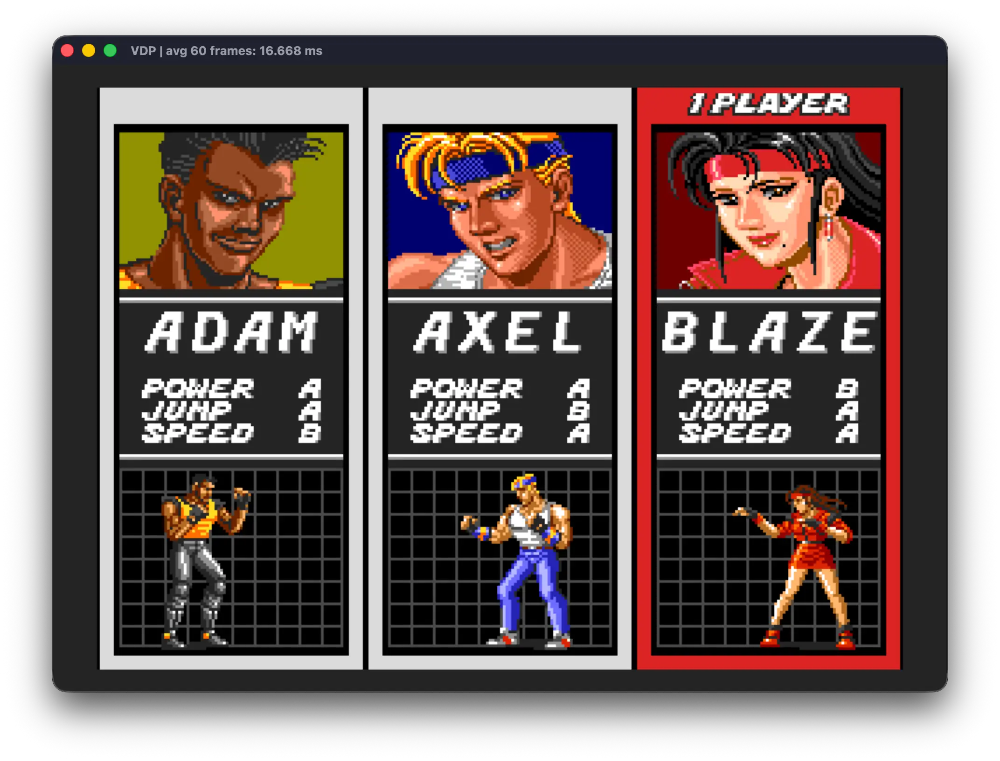
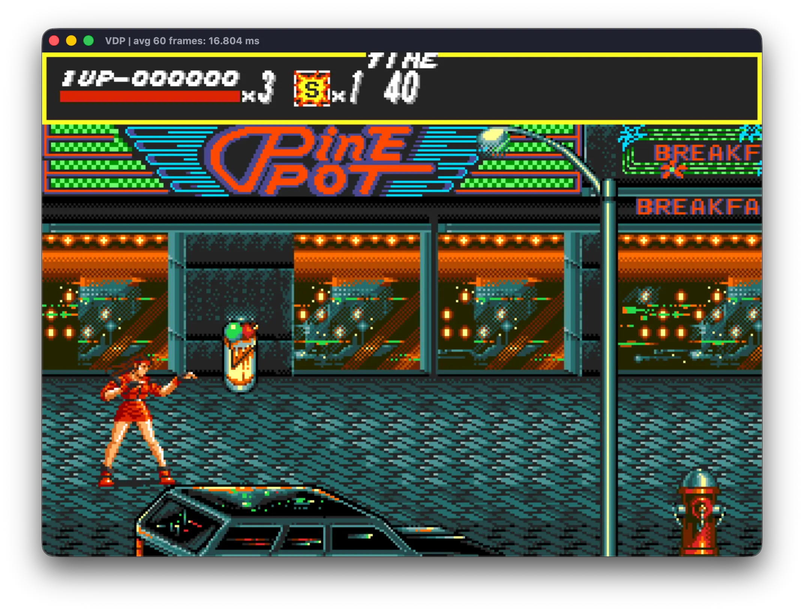
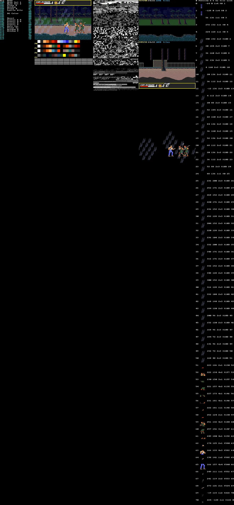

# Streets of Rage Project

<p align="center">
 
</p>

Welcome to my reverse-engineering and recompilation project for SEGA's
celebrated Mega Drive classic (released as SEGA Genesis in the United States),
*Streets of Rage*.

This is a strictly academic, non-commercial project. If you are looking for a
free copy of the game, this repository is not the place to find one: **it does
not contain copyrighted game material**. The original ROM is deliberately
omitted; you must provide a compatible image that you are legally entitled to
use.

The project brings together several components whose primary purpose is to
recompile Streets of Rage faithfully and make its internals available for
study.

## Project structure

<p align="center">
 
</p>

| Submodule / directory | Purpose |
| --- | --- |
| [`MegaDriveEnvironment/`](MegaDriveEnvironment/) | SDL3-based Mega Drive host runtime and reusable C++ library |
| [`StreetsOfRageRecompilation/`](StreetsOfRageRecompilation/) | Generated and hand-written C++, analysis data, build scripts, and the `sor` executable |
| [`RageDecompiler/`](RageDecompiler/) | Python tools for disassembly, recompilation, label generation, and runtime discovery |
| [`MegaDriveEnvironmentSampleGame/`](MegaDriveEnvironmentSampleGame/) | A small game targeting both the PC runtime and real Mega Drive hardware |
| [`autoplay/`](autoplay/) | Python remote observer and symbolic AI player for a running `sor` host |
| [`StreetsOfRageBuilder/`](StreetsOfRageBuilder/) | Guided installer that sets up the tools, builds the game from your ROM and adds a desktop shortcut |

The playable host expects `MegaDriveEnvironment`, `RageDecompiler`, and
`StreetsOfRageRecompilation` to remain sibling directories. This is the layout
created by the meta-repository.

### Acknowledgments

I would like to thank [ekeeke for the Genesis Plus GX](https://github.com/ekeeke/genesis-plus-gx), which served almost as technical documentation for the SEGA Mega Drive, and [gsaurus for the Streets of Rage](https://github.com/gsaurus/sor-disassemblies/) disassembly (and annotations), which provided an important starting point for the analysis of the game. And of course, my slaves: Claude, ChatGPT, and Grok 4.5. Without them, this work would be impossible for my meat brain to do as a side project!

### The `RageDecompiler` recompiler

`RageDecompiler` disassembles the ROM into assembly and also transpiles the
required routines into C++ for the desktop build.

Minimal code generation is a deliberate design goal: the tool should emit no
more code than is necessary to execute the game. Particular care has been
taken with the challenges of translating an assembly-language program that
relies on patterns such as jump tables.

The recompiler is designed to operate in concert with the executable it
produces. During bootstrap, it recompiles the routines reachable from address
`0x200` and from the interrupt autovectors, together with every routine reached
through a direct call from those entry points.

Some subroutines, however, are not reachable through direct calls. To account
for them, the disassembler/recompiler consumes the auxiliary file
`StreetsOfRageRecompilation/code-analysis/aux_addresses.txt`. This file records
call-site addresses and tells the recompiler where to look for additional
functions. At runtime, `StreetsOfRageRecompilation` writes to *stdout* the
addresses that are called but do not yet have an equivalent compiled function.

The initial assumption was that exercising the game would expose a small set
of entry points and that most of the remaining routines would be reached from
them. In practice, the control-flow structure is substantially more complex;
the same subroutine may also be referenced by multiple call sites.

The project therefore includes a speculative discovery mode. The recompiler
searches the ROM for plausible code, emits it, and provides support for
potential call sites. As the game runs, confirmed addresses are added to
`aux_addresses.txt`. This makes it possible to discover dozens or hundreds of
addresses in a single compilation without restarting the game.

The discovery loop is:

**exercise the game** → **record new addresses** → **recompile** → **play again**

The project supports both conservative discovery and a smart mode that uses
speculative addresses.

### The `MegaDriveEnvironment` development and runtime library

Producing code that could execute directly on a PC would be impractical while
the recompilation still depends on the Mega Drive's video, audio, and input
subsystems.

`MegaDriveEnvironment` serves two closely related purposes. It can be used to
develop Mega Drive games as native PC applications: instead of targeting APIs
such as Vulkan or DirectX, the application uses an emulated Mega Drive VDP
(Video Display Processor). The same approach is used for controllers and
audio.

These emulated devices use SDL3 to communicate with the host operating
system's native APIs. As a result, between 90% and 100% of a Mega Drive game
can be developed as a PC application, while the same source can also produce a
ROM image for an emulator or original hardware. The source can likewise be
used to build a conventional application for PC, macOS, or Linux.

The accompanying `MegaDriveEnvironmentSampleGame` demonstrates this
cross-platform workflow, including a basic resource-packaging system for tiles,
audio samples, and Z80 programs.

Beyond development support, `MegaDriveEnvironment` provides the emulated VDP,
audio, controllers, and related devices that allow the static Streets of Rage
recompilation to run before its rendering engine, audio system, and other
hardware-facing subsystems have been reimplemented.

The long-term roadmap is:

1. Reimplement every game procedure in C++.
2. Make that C++ readable — named routines, fields, and constants in place of
   translated opcodes — while preserving the original gameplay rules. The game
   state stays in the original Mega Drive work RAM, at the original addresses
   and in the original formats, and is updated on the same frames as before:
   the [`autoplay`](#the-autoplay-observer-and-symbolic-ai) AI reads the game
   by address, so moving that state into C++ objects or dynamic memory would
   blind it.
3. Remove the dependency on the hardware emulated by `MegaDriveEnvironment`
   and implement the graphics pipeline, audio (already bypassed), and input directly through SDL.
   This replaces the emulated devices, not the work-RAM layout.
4. Enable enhancements such as higher-resolution replacement assets and variable frame rates through rendering interpolation, so the
   game logic still advances one original frame at a time.

### The recompiled game in `StreetsOfRageRecompilation`

The combination of the preceding tools produces the recompiled game in
`StreetsOfRageRecompilation`. That repository also contains the results of
several lines of analysis:

#### `output`

`RageDecompiler` can emit the recompiled game as C++ and can also produce an
assembly representation. The assembly is useful for human inspection and,
especially, for enabling LLMs to study the original program's behavior and
structure.

#### `ai-analysis`

Contains analyses of the code produced by multiple frontier-level language
models.

#### `code-analysis`

Contains the data that guides recompilation and analysis, including labels,
auxiliary addresses, and the list of manually reimplemented functions.

#### `generated`

Contains the C++ generated from the ROM. This directory is ignored by Git and
must be recreated after a fresh clone or whenever the ROM, analysis data, or
recompiler changes.

#### Hand-written code

Some parts of the program have already been reimplemented, with assistance
from LLMs, while preserving maximum compatibility with the remaining
recompiler-generated code. These parts include routines such as the
compressor/decompressor and substitutes for the "wait for VBlank" routines
that use busy waiting.

### The `autoplay` observer and symbolic AI

`autoplay` is a Python application that attaches to a running `sor` executable
through the remote-access library shipped with `MegaDriveEnvironment`
(`megadrive_remote`). The game process remains the host; autoplay reads live
state over the remote connection and, when its AI is enabled, plays the game
through a virtual gamepad.

The app provides a live HUD that reports game mode, level, wave, timer, and
per-player status, together with a 2D world map of on-screen and off-camera
actors (including combat-phase outlines and hunt counts).

#### The AI player

The AI is symbolic, not learned: there is no training and no neural network.
It is built on what the reverse-engineering uncovered — the disassembly, the
labels, and the `ai-analysis` manuscripts — so it can anticipate an enemy
because it knows the routine that drives that enemy. It can be switched on for
player 1, player 2, or both. It may read RAM freely but never writes it: every
action goes through the controller, exactly as a human player's would (the
original A/B/C scheme only, for now).

Each poll runs one pass of a pipeline built on *tokens*:

1. **Observe** — turn the snapshot the HUD already reads into `Information`
   tokens: both players, each enemy and boss as its own class, weapons, food,
   and hazards.
2. **Infer** — derive the few facts that need calculation, such as being
   surrounded.
3. **Propose** — generate every `Verb` that currently makes sense: walk,
   punch, jump-kick, grab and suplex, throw a knife, dodge a projectile, open a
   breakable, advance the stage, call the police.
4. **Filter** — withdraw any verb that would hit the other player, human or
   AI.
5. **Rank** — score each verb's urgency from the information present and keep
   the winner. The HUD shows it, along with the candidates it beat.
6. **Execute** — the winning verb selects a small, non-blocking state machine
   that produces this tick's buttons.

General rules only go so far in a fight, so the harder opponents get *ROM
models*: Python restatements of an enemy's state machine, timings, and
hitboxes, which the AI plays forward to choose its next move. The street
enemies (Garcia, Signal, Haku-Ro, and Nora) share one lookahead, while Jack and
every boss — Antonio, Souther, Abadede, Bongo, Onihime & Yasha, and Mr. X —
have a model and plan of their own. Movement relies on a standalone rectangle
path finder that steers around walls, floor holes, props, and round 6's drop
press.

No behaviour change ships without being measured against the running game.
The Python helpers put the AI straight in front of any round's boss
(`scripts/play.py --preset boss --level N`), run it in turbo, or let it step the game
frame by frame in lockstep, and a recorded stall can be replayed offline
through the real pipeline.

The design is described in [`autoplay/AI.md`](autoplay/AI.md); launch
instructions and CLI options are in [`autoplay/README.md`](autoplay/README.md);
the ROM models, measurements, and test procedures are in
[`autoplay/CLAUDE.md`](autoplay/CLAUDE.md).

## How to build

<p align="center">
 
</p>

### Using the Builder (recommended)

The easiest way to get the game running is **Streets of Rage Builder**, a guided
installer for Windows, macOS and Debian-based Linux (Ubuntu and similar). It
does for you the steps of [building by hand](#building-by-hand); you only need a ROM you
are legally entitled to use (see [Obtain a compatible ROM](#2-obtain-a-compatible-rom)).
The ROM must be the **Rev. A** dump (CRC32 `4052E845`).

#### Download and open the Builder

Get the file for your system from the
[latest release](https://github.com/RuiNelson/StreetsOfRageProject/releases/latest):

| System | File |
| --- | --- |
| macOS (Apple silicon and Intel) | `StreetsOfRageBuilder-X.Y.Z-macos-universal.dmg` |
| Windows (64-bit Intel/AMD) | `StreetsOfRageBuilder-X.Y.Z-windows-x64.exe` |
| Windows on ARM | `StreetsOfRageBuilder-X.Y.Z-windows-arm64.exe` |
| Linux x64 | `StreetsOfRageBuilder-X.Y.Z-linux-x64.AppImage` |
| Linux ARM64 | `StreetsOfRageBuilder-X.Y.Z-linux-arm64.AppImage` |

The apps are not signed yet, so macOS, Windows and your browser will warn you the
first time; the release page explains how to open them.

#### Follow the six steps

The window lists the steps on the left; **Back** and **Next** are at the bottom.
**Next** is enabled when a step is done.

1. **Install Tools**: checks Git, CMake, Ninja, Python (with Tk) and a C++
   compiler, and installs what is missing with WinGet, Homebrew or apt. The
   installers open in a terminal window and may ask for your password or
   administrator approval. When they finish, the Builder checks again by itself
   (or press **Re-check**).
2. **Download Source**: choose an empty or new folder for the project. It is
   downloaded from GitHub with its submodules and a single commit of history. To
   update later, choose the same folder again.
3. **Copy ROM**: drag your ROM onto the window or browse for it (`.bin`, `.md`,
   `.gen`). Its CRC32 is checked, and it is copied into the project only if it
   is the right dump. A Super Magic Drive (`.smd`) dump must first be converted
   to a raw dump; any other version of the cartridge is not supported.
4. **Pre-render Soundtrack**: renders the music and sound effects from your ROM
   (about 4 minutes or more, ~265 MB). You can pick the sound chip: YM3438
   (default) or YM2612. Keep the window open.
5. **Build Executable**: generates the C++ from the ROM and compiles the game
   and its dependencies; it takes several minutes, longer on slow computers.
6. **Create Shortcut**: adds a **Streets of Rage** shortcut to your desktop. Click
   **Finish** to close the Builder.

Then double-click the shortcut to open the launcher window, and see
[Play](#play) for the controls.

If a step fails, the last lines of its output are shown; fix the cause (for
example, a missing tool) and run the step again.

### Building by hand

The steps below do by hand what the Builder does. Follow them if you prefer, or if
your system is not supported by the Builder.

### 1. Clone the repository and submodules

```bash
git clone --recurse-submodules https://github.com/RuiNelson/StreetsOfRageProject.git
cd StreetsOfRageProject
```

If the repository was cloned without submodules:

```bash
git submodule update --init --recursive
```

To restore all submodules to the commits recorded by the meta-repository:

```bash
git submodule update --init --recursive --checkout
```

### 2. Obtain a compatible ROM

The generated C++ under `StreetsOfRageRecompilation/generated/` is ignored by
Git and is not included in a fresh clone. Before the first build, generate it
from a compatible 512 KiB Streets of Rage / Bare Knuckle ROM image at:

```text
StreetsOfRageRecompilation/rom/SOR.bin
```

#### Legal and preservation considerations

The preferred way to obtain this image is to make a private dump of a physical
cartridge that you own, or that you are otherwise explicitly authorized to
access, using a compatible Mega Drive cartridge dumper. Follow the dumper's
documentation and verify the resulting file against the reference hashes
below. This approach also contributes to responsible preservation: it keeps the
source of the image clear and avoids relying on unverified downloads.

Copyright, archival-copy, reverse-engineering, and anti-circumvention rules
differ substantially between jurisdictions. Owning a cartridge does not
necessarily grant permission to redistribute its ROM, upload it, include it in
this repository, or bypass technical protection measures. Check the law that
applies to you before making or using a dump; this project provides technical
documentation, not legal advice. Keep the ROM private, use it only as permitted
by the applicable law, and do not share it with the project or its community.

The project is developed against the `JUE` cartridge, with these hashes:

| Property | Value |
| --- | --- |
| Size | `524288` bytes |
| CRC32 | `4052E845` |
| MD5 | `59a3b22a1899461dceba50d1ade88d3a` |
| SHA-256 | `95d7efb98e97f4ffffe68257aef9a855034a36a41b86cf9d332d129f30cb2d4b` |

ROM images are ignored by Git. Do not commit or redistribute them.

### 3. Common prerequisites

All three desktop platforms require:

- Git, including submodule support;
- CMake 3.24 or newer;
- a compiler with C++23 support;
- network access during the first configuration, because CMake downloads CLI11,
  yaml-cpp, zlib, libpng, SDL3_mixer, and SDL3 itself unless it is already
  installed (and, for the soundtrack renderer, Genesis Plus GX and libFLAC);
- Python 3 for the first C++ generation and the analysis tools;
- a compatible local ROM for the mandatory first C++ generation.

Check the main tools before configuring:

```bash
git --version
cmake --version
python3 --version
```

The repository's `scripts/*.py` launchers generate, build, and run the port on
all three desktop platforms, and use only the Python standard library. On
Windows invoke them with `py scripts\NAME.py`; on macOS and Linux they are
executable directly as `./scripts/NAME.py`. Run them from the meta-repository
root.

### 5. Build on Windows

#### Prerequisites

Open PowerShell as Administrator and install the command-line tools with
[WinGet](https://learn.microsoft.com/windows/package-manager/winget/):

```powershell
winget source update

winget install --exact --id Git.Git

winget install --exact --id Kitware.CMake

winget install --exact --id Ninja-build.Ninja

winget install --exact --id Python.Python.3.14

winget install --exact --id MartinStorsjo.LLVM-MinGW.UCRT
```

The compiler is [llvm-mingw](https://github.com/mstorsjo/llvm-mingw): Clang,
LLD and libc++ for Windows, about a gigabyte, with no Visual Studio and no
Windows SDK. The game is built for the UCRT, so it runs on any current Windows.

> Important: close the terminal and open a new PowerShell (so that the new
programs are on `PATH`)

Confirm that the tools are available:

```powershell
x86_64-w64-mingw32-clang --version   # aarch64-w64-mingw32-clang on Windows on ARM
git --version
cmake --version
ninja --version
py --version
```


#### Configure, compile, and run

Run the following from the meta-repository root in PowerShell.

After a fresh clone, generate the C++ port and create an optimized build:

```powershell
py .\scripts\generate_cpp_and_build.py --release
```

Generation is mandatory after a fresh clone.

Extract the soundtrack from your ROM (about 4 minutes, ~265 MB). Without it the
game still runs, but the sound is emulated in real time and is noticeably worse:

```powershell
py .\scripts\render_soundtrack.py
```

Run the game. There is a handy `play.py` launcher that is easy to use (**this might take a while on the first run**):

```powershell
py .\scripts\play.py
```

### 6. Build on macOS

#### Prerequisites

Install the Xcode command-line tools and [Homebrew](https://brew.sh) dependencies:

```bash
xcode-select --install
brew install cmake ninja python python-tk
```

Both Apple Silicon and Intel Macs are supported. Keep CMake, the compiler, and
SDL3 on the same architecture.

#### Configure, compile, and run

After a fresh clone, generate the C++ port and create an optimized build:

```bash
./scripts/generate_cpp_and_build.py --release
```

Extract the soundtrack from your ROM (about 4 minutes, ~265 MB). Without it the
game still runs, but the sound is emulated in real time and is noticeably worse:

```bash
./scripts/render_soundtrack.py
```

Run the port:

```bash
./scripts/play.py
```


### 7. Build on Ubuntu

#### Prerequisites

Install the compiler and build tools:

```bash
sudo apt update
sudo apt install build-essential cmake git ninja-build python3 python3-tk pkg-config
```

Confirm that `cmake --version` reports 3.24 or newer. SDL3 is downloaded and
built by CMake, which needs SDL's usual system development packages:

```bash
sudo apt install libasound2-dev libpulse-dev libx11-dev libxext-dev \
  libxrandr-dev libxcursor-dev libxfixes-dev libxi-dev libxss-dev \
  libxkbcommon-dev libdrm-dev libgbm-dev libgl1-mesa-dev libegl1-mesa-dev \
  libdbus-1-dev libudev-dev libwayland-dev libdecor-0-dev
```

#### Configure, compile, and run

Generate the C++ port and create the first optimized build:

```bash
./scripts/generate_cpp_and_build.py --release
```

Extract the soundtrack from your ROM (about 4 minutes, ~265 MB). Without it the
game still runs, but the sound is emulated in real time and is noticeably worse:

```bash
./scripts/render_soundtrack.py
```

Run the port:

```bash
./scripts/play.py
```


### Play

#### Default controls

The game reads the keyboard and gamepads itself and binds them to actions, not
to Mega Drive buttons. Each player has a control scheme:

- **ORIGINAL 3** (the default): Special, Punch and Jump, the original
  three-button game (Punch picks items up, Punch+Jump is the back attack);
- **ENHANCED 6**: also Back Attack, Pick Item (a slightly wider reach than the
  original) and Throw Knife; Punch never picks up, and Punch with a knife
  stabs.

| Action | Player 1 | Player 2 | Gamepad |
| --- | --- | --- | --- |
| Directions | Arrow keys | `W` `S` `A` `D` | D-pad and left stick |
| Special (police call) | `Z` | `H` | Right trigger (ORIGINAL 3), East button (ENHANCED 6) |
| Punch | `X` | `J` | West button |
| Jump | `C` | `K` | South button |
| Back Attack (ENHANCED 6) | `V` | `Y` | Left trigger |
| Pick Item (ENHANCED 6) | `B` | `U` | North button |
| Throw Knife (ENHANCED 6) | `N` | `I` | Right trigger |
| Start | `V` (ORIGINAL 3), `M` (ENHANCED 6) | `L` | Start |

Player 1 gets the first gamepad found and player 2 the next one.

#### Configure keyboard and gamepad bindings

In the game, open **OPTIONS > CONTROLS** and choose **PLAYER 1** or
**PLAYER 2**:

| Entry | What it does |
| --- | --- |
| SCHEME | ORIGINAL 3 or ENHANCED 6 (Left/Right or confirm) |
| DEVICE | AUTO (the first free gamepad), one of the detected gamepads, or NONE |
| BIND GAMEPAD | Press a button for each action in turn (only with a gamepad) |
| BIND KEYBOARD | Press a key for each direction, action and Start in turn (only with a keyboard) |
| JOYSTICK DEADZONE | Shows the left stick and its tilt; Left/Right change the deadzone (only with a gamepad) |
| BACK | Back to CONTROLS |

Any keyboard or gamepad moves through these screens: the arrows or the D-pad
(or either player's direction keys), Enter, the South button or any Punch,
Jump or Special binding to confirm, and Start or Esc to go back. While
binding, a key or button already given to an earlier action is refused, and
Start (on any gamepad) or Esc cancels without changing anything.

The controls are saved at once in
`~/.config/StreetsOfRageProject/controls.yaml`
(`%USERPROFILE%\.config\StreetsOfRageProject\controls.yaml` on Windows),
which is created with the defaults above on the first run and can also be
edited by hand: each player has a `scheme` (`original3` or `enhanced6`), a
`gamepad` (`auto`, `none`, or `device` with `gamepad_guid`), a left-stick
`deadzone` in percent, and keyboard and gamepad bindings for each scheme (SDL
key names such as `Z` or `Left Shift`; gamepad inputs by position: `South`,
`East`, `West`, `North`, `LeftShoulder`, `RightShoulder`, `LeftTrigger`,
`RightTrigger`, ...).

#### Host keyboard shortcuts

These shortcuts operate at the host-runtime level and are independent of the
gamepad bindings:

| Shortcut | Availability | Effect |
| --- | --- | --- |
| `Ctrl+F` | Always | Toggle desktop fullscreen |
| `Ctrl+Q` | Always | Request an orderly shutdown |
| `Ctrl+R` | `--debugUtils` | Cold-restart the game while preserving the process and remote TCP connection |
| `Ctrl+P` | `--debugUtils` | Save the composited frame as `screenshot_NNN.png` |
| `Ctrl+S` | `--debugUtils` | Save a complete VDP diagnostic view as `vdp_NNN.png`, including the frame, tile sheets, nametables, and registers |

The capture files are written to the process's current working directory.
`Ctrl+R`, `Ctrl+P`, and `Ctrl+S` are inactive unless `--debugUtils` is set.

#### Debug utility hotkeys (Cheats)

When started with `--debugUtils`, the host also exposes optional keyboard
cheats. Hold **Alt** on Windows/Linux or **Option** on macOS and press the
corresponding key. The unmodified key alone has no effect; gamepad modifier
chords are not handled by these host-side cheats.

| Shortcut | Effect |
| --- | --- |
| `Alt/Option+L` | Add one Player 1 life, capped at `0xFF` |
| `Alt/Option+S` | Add one Player 1 special attack, capped at `0xFF` |
| `Alt/Option+P` | Toggle Player 1 punch damage ×12, capped at the cartridge's maximum damage nibble |
| `Alt/Option+K` | Kill all instantiated enemies, including bosses, through their normal lethal states |
| `Alt/Option+W` | Call the police for the active player without consuming a special attack |
| `Alt/Option+1`–`8` | Jump to levels 1–8 and enter the corresponding level-intro state |
| `Alt/Option+G` | Kill every instantiated **Garcia** (types `$20`–`$23`) |
| `Alt/Option+N` | Kill every instantiated **Haku-Ro** — the ninja (types `$25`, `$2A`) |
| `Alt/Option+B` | Kill every instantiated **Signal** (type `$24`) |
| `Alt/Option+J` | Kill every instantiated **Jack** (type `$27`) |
| `Alt/Option+U` | Kill every instantiated **Nora** (type `$26`) |
| `Alt/Option+X` | Round 8: kill every enemy and boss instantiated on the way to **Mr. X** -- does nothing once his office scene is up (types `$33`-`$35`), so his Garcias and he are left to fight |

The per-family kills put each enemy through the same forced-death sweep as
`Alt/Option+K`, so score, HUD, and cleanup run exactly as they do for a normal
defeat. They cover ordinary enemies only: bosses have their own lethal paths
and no family cheat names one (`Alt/Option+X` is the one exception, for the
rush before Mr. X). Each letter is the enemy's own initial where
that was free — Signal takes `B` and Nora takes `U`, since `S` already adds a
special attack and `N` is the ninja.

These are host debugging facilities, not part of the original cartridge input
protocol. Use them only when investigating runtime behavior or exercising
specific game paths.

#### Startup flags

The `sor` executable accepts the following command-line options. `--help`
prints the CLI11-generated help screen, and `--version` prints the executable
version.

| Flag | Meaning |
| --- | --- |
| `--rom PATH` | ROM image to load; default: `rom/SOR.bin` |
| `--lang jp\|en` | Console language pin: `jp` is Japanese/domestic; `en` is overseas; default: `jp` |
| `--hz 50\|60` | Console video-standard pin: `60` is NTSC/low and `50` is PAL/high; default: `60` |
| `--silent` | Disable audio output completely by dropping audio-chip writes (no pre-rendered soundtrack either) |
| `--sound prerendered\|emulated` | Audio source: `prerendered` plays the FLAC soundtrack rendered by `scripts/render_soundtrack.py` (default; falls back to `emulated` when it is missing), `emulated` runs the YM2612, PSG and Z80 DAC in real time; see [Pre-rendered soundtrack](#pre-rendered-soundtrack) |
| `--soundtrack DIR` | Pre-rendered soundtrack directory; default: `soundtrack/` next to the ROM |
| `--debug` | Log CPU and VDP state once per second |
| `--debugUtils` | Enable debug hotkeys, host cheats, and remote access |
| `--fullScreen` | Start in desktop fullscreen |
| `--vsync 0\|1\|2\|3` | Frame synchronization: `0` uses the internal timer (default), `1` uses display VSync, `2` uses half-rate VSync, and `3` uses third-rate VSync |
| `--widescreen` | Use VDP Mode 48 (48×27 tiles, 384×216) instead of Mode 40; a host-only mode the hardware does not have, see [Widescreen](#widescreen-mode-48) |
| `--integerScaling` | Scale the picture by whole multiples only, centred with borders (320×224 in a 1920×1080 window or monitor is drawn 4× at 1280×896 instead of filling the height), nearest-neighbour |
| `--turbo N` | With `--vsync 0`, run the internal VDP at `60 × N` Hz; `N` must be a positive integer |
| `--port PORT` | With `--debugUtils`, select the remote-access TCP port; default: `6969`; `0` disables remote access |
| `--auxAddrFile PATH` | Discovery mode: append an unknown indirect-dispatch address to this file and exit with status `42` instead of aborting |
| `--callLog PATH` | Write every 68000 subroutine entry and call to a typed CSV log (six-digit hexadecimal ROM addresses); the file is replaced on startup |

### Widescreen (Mode 48)

`--widescreen` swaps Mode 40 (320×224) for Mode 48, a host-only VDP mode that
real hardware does not have. The picture is 48×27 tiles (384×216, 16:9). The game logic is unchanged,
so the extra columns show whatever the game already leaves in the planes and sprite table:

- every layer shows 4 more tiles on each side: layers A and B, and the sprites
  (X 96-480), so sprites stay exactly where they are on their background;
- the window plane keeps its 40 columns, centred on screen;
- the first tile row of every layer is not displayed;
- the gameplay HUD loses its yellow frame and gray plate and moves one tile
  down, so it clears the hidden first row.

Remote-access framebuffer snapshots and debug PNGs are 384×216 too.

### Pre-rendered soundtrack

The game makes its music on the 68000 and spends a lot of CPU in bus
handshakes with the Z80 that cost nothing on the console, so the host's
real-time chip emulation sounds worse than an accurate emulator. Instead, `sor`
plays a soundtrack pre-rendered from your ROM by
[Genesis Plus GX](https://github.com/ekeeke/genesis-plus-gx) with the Nuked
OPN2 core (YM3438, no low-pass filter, 48 kHz, lossless FLAC): every music
track (looping forever from its own loop point, like on the console), every
sound effect and every PCM voice. It is extracted with
`scripts/render_soundtrack.py`, the last step of the build for your platform
([Windows](#5-build-on-windows), [macOS](#6-build-on-macos),
[Ubuntu](#7-build-on-ubuntu)); it takes about four minutes and writes ~265 MB to
`StreetsOfRageRecompilation/rom/soundtrack/`, next to the ROM.

A soundtrack folder is the FLAC files plus their `manifest.tsv`. By default
`sor` reads `soundtrack/` next to the ROM; point it at another folder with
`--soundtrack DIR` (for example a second render with the other chip):

```bash
./build/sor --rom rom/SOR.bin --soundtrack ~/sor-audio
./build/sor --rom rom/SOR.bin --sound emulated   # the real-time chips instead
```

`render_soundtrack.py` takes two options for such a second render:
`--chip ym2612` renders Nuked's Model 1 YM2612 instead of the default YM3438, and
`--out DIR` writes to another folder.

In the `scripts/play.py` window the same choices are the **Sound** and
**Soundtrack folder** fields of the host panel (empty folder = next to the
ROM; the `...` button opens a folder chooser). The command line keeps a missing
soundtrack as a warning: `sor` then emulates the chips.

The renders come from the copyrighted ROM, so they stay next to it and are
never versioned. The game's own sound engine still runs; only its chip output
is replaced, so music starts, fades, the pause jingle and the stop commands
happen on the same frames as on hardware. Each music track is stored as two
stems that add up to the full mix, the FM channels and the drums (DAC) plus
PSG, because the game's fade treats them differently: the drums and the PSG
stop at once while the FM fades out over 1.3 seconds. One difference is deliberate: on the
console a sound effect borrows a music channel while it plays, here the music
keeps playing under it. Under `--turbo` the music stays at normal speed.

Examples:

```bash
./build/sor --rom rom/SOR.bin --lang en --hz 60 --vsync 1 --debugUtils --port 6970
./build/sor --rom rom/SOR.bin --fullScreen
./build/sor --rom rom/SOR.bin --turbo 2 --silent
./build/sor --rom rom/SOR.bin --callLog calls.csv
```

### Call-map database

Collapse a runtime call log into unique observed control-flow relationships:

```bash
cd StreetsOfRageRecompilation
python3 tools/call_map.py ../calls.csv \
  --database call-map.sqlite
```

New logs have the header `event,source,callsite,target`. A `call` row fills all
three address fields; an `entry` row uses `source` for the entered routine and
leaves `callsite` and `target` empty. The tool also accepts legacy three-column
call logs.

The SQLite database keeps every routine from `labels.csv`, including routines
with no activity in the captured run. Dynamic entry counts are stored in
`subroutine_entry`; deduplicated calls use `callsite`, `call_edge`, and
`callsite_target`. The `subroutine_activity`, `subroutine_flow`, and
`callsite_flow` views provide human-readable queries:

```bash
sqlite3 -header -column call-map.sqlite \
  'SELECT * FROM callsite_flow ORDER BY observed_count DESC LIMIT 20;'
```

Pass `--port` to start the interactive web viewer after generating the
database. `--labels` selects the labels file used for subroutine names:

```bash
python3 tools/call_map.py ../calls.csv \
  --database call-map.sqlite \
  --port 8080 \
  --labels code-analysis/labels.csv
```

Open `http://127.0.0.1:8080` to search all known routines, distinguish executed
entries from labelled-only routines, inspect observed call counts, and navigate
incoming and outgoing calls including their callsites. The server binds only
to localhost by default; pass `--host` explicitly to expose it on a different
interface.

Current logs record the dynamic 68000 entry as their source, including when
several entries share one generated C++ body. The tool always preserves a
source already present in `labels.csv`. For older logs it approximates
anonymous grouped C++ owners from the closest label; use
`--trust-recorded-source` to disable that approximation. Since old logs cannot
reliably reconstruct every non-contiguous entry, regenerate the log after
recompiling when an expected routine such as `$019D16` is absent.
