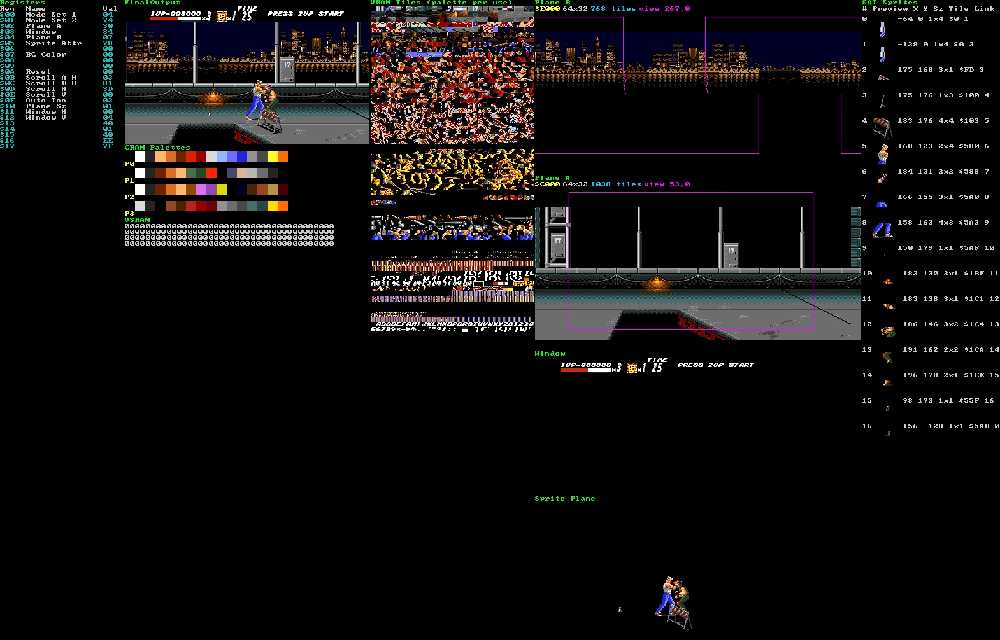
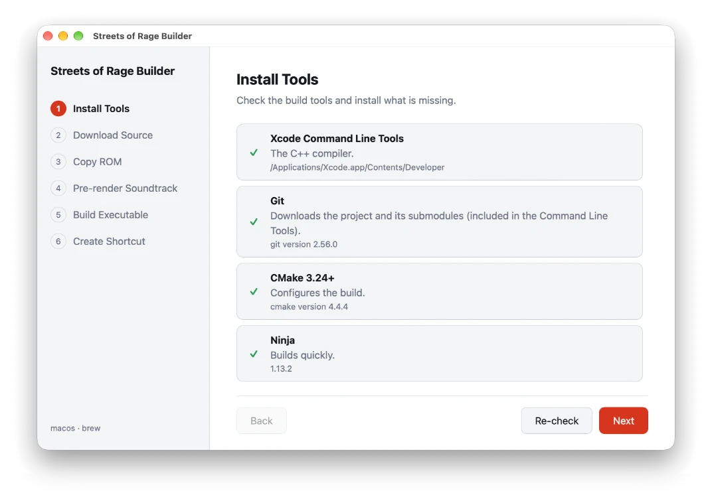

# Building for Windows, macOS and Linux

[Back to the README](../README.md)



There are two ways to get the game running, and both need
[a ROM you are entitled to use](#step-3-obtain-a-compatible-rom):

- **[The Builder](#using-the-builder-recommended)** is a guided window that does everything for you.
  Use it unless you have a reason not to.
- **[By hand](#building-by-hand)** gives you the same result from a terminal, and it is the route to
  take if you want to change the code or your system is not one the Builder supports.

For the console, see [Building for PlayStation 5](BuildingPS5.md).

## Using the Builder (recommended)



**Streets of Rage Builder** runs on Windows, macOS and Debian-based Linux (Ubuntu and similar).

### 1. Download it

Get the file for your system from the
[latest release](https://github.com/RuiNelson/StreetsOfRageProject/releases/latest):

| System                          | File                                             |
| ------------------------------- | ------------------------------------------------ |
| macOS (Apple silicon and Intel) | `StreetsOfRageBuilder-X.Y.Z-macos-universal.dmg` |
| Windows (64-bit Intel/AMD)      | `StreetsOfRageBuilder-X.Y.Z-windows-x64.exe`     |
| Windows on ARM                  | `StreetsOfRageBuilder-X.Y.Z-windows-arm64.exe`   |
| Linux x64                       | `StreetsOfRageBuilder-X.Y.Z-x86_64.AppImage`     |
| Linux ARM64                     | `StreetsOfRageBuilder-X.Y.Z-aarch64.AppImage`    |

The apps are not signed yet, so macOS, Windows and your browser will warn you the first time. The
release page explains how to open them.

### 2. Follow the steps

The steps are listed on the left of the window. **Next** becomes available when a step is done.

1. **Choose Target:** this computer. The other choice is the
   [PlayStation 5](BuildingPS5.md#using-the-builder).
2. **Install Tools:** the Builder checks for Git, CMake, Ninja, Python (with Tk) and a C++ compiler,
   and installs what is missing with WinGet, Homebrew or apt. The installers open in a terminal
   window and may ask for your password or an administrator's approval. The Builder checks again
   when they finish, or when you press **Re-check**.
3. **Download Source:** choose an empty or new folder. The Builder downloads the version of the
   project that matches it. To update later, choose the same folder in a newer Builder.
4. **Copy ROM:** drag your ROM onto the window or browse for it (`.bin`, `.md` or `.gen`). It is
   copied into the project only if it is the right dump.
5. **Pre-render Soundtrack:** renders the music and sound effects from your ROM, which takes about 4
   minutes or more and about 265 MB. You can pick the sound chip: YM3438 (the default) or YM2612.
   Keep the window open.
6. **Build Executable:** generates the C++ and compiles the game. This takes several minutes, longer
   on a slow computer.
7. **Create Shortcut:** adds **StreetsOfRageRecompilation**, which starts the game, and
   **StreetsOfRageRecompilation Launcher**, which opens a window with all the options. On Windows and
   Linux they go on your desktop. On macOS they are two apps in a `StreetsOfRageProject` folder, in
   Applications or your home folder as you choose, and the game's app holds a copy of everything it
   needs, including your ROM.

Click **Finish**, then double-click **StreetsOfRageRecompilation** to play. [Playing](Playing.md)
has the controls.

If a step fails, the Builder shows the last lines of its output. Fix the cause (a missing tool, for
example) and run the step again.

## Building by hand

Run every command from the root of the repository. The `scripts/*.py` launchers work the same on all
three systems and use only the Python standard library: on Windows call them as
`py .\scripts\NAME.py`, and on macOS and Linux as `./scripts/NAME.py`.

### Step 1: Install the tools

You need Git, CMake 3.24 or newer, Ninja, a compiler with C++23 support, and Python 3 with Tk.

The first build also needs network access. CMake downloads CLI11, yaml-cpp, zlib, libpng, SDL3_mixer
and SDL3 (unless already installed), plus Genesis Plus GX and libFLAC for the soundtrack renderer. It
also fetches the CPython that runs the AI in **1 PLAYER AI ASSIST**: Windows downloads the official
build, while macOS and Linux compile it once, in about two minutes. That Python is independent of
any other on your machine.

#### Windows

Open PowerShell as Administrator and install everything with
[WinGet](https://learn.microsoft.com/windows/package-manager/winget/):

```powershell
winget source update
```

```powershell
winget install --exact --id Git.Git
```

```powershell
winget install --exact --id Kitware.CMake
```

```powershell
winget install --exact --id Ninja-build.Ninja
```

```powershell
winget install --exact --id Python.Python.3.14
```

```powershell
winget install --exact --id MartinStorsjo.LLVM-MinGW.UCRT
```

The compiler is [llvm-mingw](https://github.com/mstorsjo/llvm-mingw): Clang, LLD and libc++ for
Windows, about a gigabyte, with no Visual Studio and no Windows SDK. The game is built for the UCRT,
so it runs on any current Windows.

**Close the terminal and open a new PowerShell**, so that the new programs are on `PATH`. Then check
that they are all there:

```powershell
x86_64-w64-mingw32-clang --version   # aarch64-w64-mingw32-clang on Windows on ARM
```

```powershell
git --version; cmake --version; ninja --version; py --version
```

#### macOS

Install the Xcode command-line tools, then the rest with [Homebrew](https://brew.sh):

```bash
xcode-select --install
```

```bash
brew install cmake ninja python python-tk
```

Both Apple silicon and Intel Macs are supported. Keep CMake, the compiler and SDL3 on the same
architecture.

#### Linux

These commands are for Ubuntu and other Debian-based systems. First the compiler and build tools:

```bash
sudo apt update
```

```bash
sudo apt install build-essential cmake git ninja-build python3 python3-tk pkg-config
```

Check that `cmake --version` reports 3.24 or newer. CMake also builds SDL3, which needs the usual
system development packages:

```bash
sudo apt install libasound2-dev libpulse-dev libx11-dev libxext-dev \
  libxrandr-dev libxcursor-dev libxfixes-dev libxi-dev libxss-dev \
  libxkbcommon-dev libdrm-dev libgbm-dev libgl1-mesa-dev libegl1-mesa-dev \
  libdbus-1-dev libudev-dev libwayland-dev libdecor-0-dev
```

### Step 2: Get the source

A build needs only the current commit of the repository and of each submodule, so clone shallow:

```bash
git clone --depth 1 --shallow-submodules --recurse-submodules https://github.com/RuiNelson/StreetsOfRageProject.git
```

```bash
cd StreetsOfRageProject
```

If you already cloned it without the submodules, or want to put them back on the commits this
repository records:

```bash
git submodule update --init --recursive --checkout --depth 1
```

### Step 3: Obtain a compatible ROM

Git does not hold the game's C++, because it is generated from your ROM. Put a 512 KiB Streets of
Rage / Bare Knuckle image, the `JUE` Rev. A cartridge, at:

```text
StreetsOfRageRecompilation/rom/SOR.bin
```

It must match these values:

| Property | Value                                                              |
| -------- | ------------------------------------------------------------------ |
| Size     | `524288` bytes                                                     |
| CRC32    | `4052E845`                                                         |
| MD5      | `59a3b22a1899461dceba50d1ade88d3a`                                 |
| SHA-256  | `95d7efb98e97f4ffffe68257aef9a855034a36a41b86cf9d332d129f30cb2d4b` |

Any other version of the cartridge is not supported. A Super Magic Drive (`.smd`) dump must first be
converted to a raw dump.

#### Legal and preservation considerations

The best source for this image is a private dump of a physical cartridge that you own, or are
explicitly authorized to access, made with a compatible Mega Drive cartridge dumper. Follow the
dumper's documentation and compare the result with the values above. It also serves preservation:
the image's origin is clear, and you are not relying on an unverified download.

Copyright, archival-copy, reverse-engineering and anti-circumvention rules differ substantially
between jurisdictions. Owning a cartridge does not necessarily allow you to redistribute its ROM,
upload it, include it in this repository or bypass technical protection measures. Check the law that
applies to you before making or using a dump; this project provides technical documentation, not
legal advice.

Keep the ROM private, use it only as the law allows, and do not share it with the project or its
community. Git ignores ROM images: do not commit or redistribute them.

### Step 4: Build and run

The first command generates the C++ and compiles an optimized build; generation is mandatory after a
fresh clone. The second extracts the soundtrack from your ROM (about 4 minutes, ~265 MB). You can
skip it and the game still runs, but with sound emulated in real time, which is noticeably worse. The
third opens the launcher; **the first run might take a while**.

#### Windows

```powershell
py .\scripts\generate_cpp_and_build.py --release
```

```powershell
py .\scripts\render_soundtrack.py
```

```powershell
py .\scripts\play.py
```

#### macOS

```bash
./scripts/generate_cpp_and_build.py --release
```

```bash
./scripts/render_soundtrack.py
```

```bash
./scripts/play.py
```

#### Linux

```bash
./scripts/generate_cpp_and_build.py --release
```

```bash
./scripts/render_soundtrack.py
```

```bash
./scripts/play.py
```

[Playing](Playing.md) has the controls and everything else the game can do.

### Building again

Generate the C++ again whenever the ROM, the analysis data or the recompiler changes, with the same
command. Leave out `--release` for a debug build, which is the one to use when working on the code.
The soundtrack needs extracting again only when the renderer changes.
