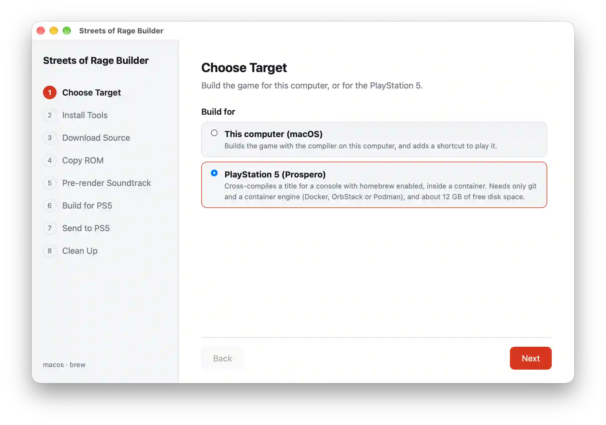

# Building for PlayStation 5

[Back to the README](../README.md)

The result is an installed homebrew title with its own tile on the home screen, drawn through
[Mesa's RADV on the console](https://github.com/mihawk-99/PS5_Vulkan). It runs only on a jailbroken
PS5 that you own, and it needs [the same ROM as the desktop builds](BuildingDesktop.md#step-3-obtain-a-compatible-rom),
because nothing copyrighted is in the title.

## Before you start

**On the console:**

- [ShadowMountPlus](https://github.com/drakmor/ShadowMountPlus) 1.7beta4 or newer
- an FTP server, if you want to send the files over the network, such as
  [my ftpsrv](https://github.com/RuiNelson/ftpsrv-streamextract),
  [drakmor's ftpsrv](https://github.com/drakmor/ftpsrv) or
  [John Törnblom's ftpsrv](https://github.com/ps5-payload-dev/ftpsrv)

**On your computer:** about 12 GB of free disk and a container engine:
[OrbStack](https://orbstack.dev/), [Docker](https://www.docker.com/products/docker-desktop/) or
[Podman](https://podman-desktop.io/). The toolchain is built inside it once, which takes a while, and
later builds reuse it.

## Choose a route

| Route                                   | Runs on                 | You also need                                                       |
| --------------------------------------- | ----------------------- | ------------------------------------------------------------------- |
| [The Builder](#using-the-builder)       | Windows, macOS, Linux   | Git, which it can install                                           |
| [The wizard](#using-the-wizard)         | Windows 11, macOS, Linux | Git, to get the repository                                          |
| [By hand](#building-by-hand)            | macOS, Linux            | The [desktop tools](BuildingDesktop.md#step-1-install-the-tools)    |

## Using the Builder



Open [Streets of Rage Builder](BuildingDesktop.md#1-download-it) and choose
**PlayStation 5 (Prospero)** in the first step. It checks Git and the container engine, downloads the
source, verifies your ROM, renders the soundtrack and builds the title. **Send to PS5** then makes the
[ZIP files](#installing-the-zip-files) or sends everything over FTP, and **Clean Up** offers to remove
what is no longer needed.

## Using the wizard

One script does the same in a terminal. On macOS and Linux:

```bash
git clone --depth 1 --shallow-submodules --recurse-submodules https://github.com/RuiNelson/StreetsOfRageProject.git
```

```bash
cd StreetsOfRageProject
```

```bash
./scripts/ps5_wizzard.sh
```

On Windows 11, with [Docker Desktop](https://www.docker.com/products/docker-desktop/) or
[Podman Desktop](https://podman-desktop.io/):

```powershell
git clone --depth 1 --shallow-submodules --recurse-submodules https://github.com/RuiNelson/StreetsOfRageProject.git
```

```powershell
cd StreetsOfRageProject
```

```powershell
.\scripts\ps5_wizzard.cmd
```

It checks your ROM, renders the soundtrack and builds the title, then makes the
[ZIP files](#installing-the-zip-files) in the current folder or sends everything over FTP, and finally
offers to clean up. The ROM and the soundtrack are kept, since they can be reused.

## Installing the ZIP files

Unpack each one on the console, then check [what the console should hold](#on-the-console-afterwards):

| File                             | Contains     | Unpack into       |
| -------------------------------- | ------------ | ----------------- |
| `StreetsOfRage-PS5-homebrew.zip` | `PPSA99872/` | `/data/homebrew/` |
| `StreetsOfRage-PS5-data.zip`     | `sor/`       | `/data/`          |

## Building by hand

Use this route on macOS or Linux if you want to work on the port. The C++ generation and the soundtrack
run on your computer, so you need the [desktop tools](BuildingDesktop.md#step-1-install-the-tools) as
well as a Docker-compatible engine. On Windows use one of the other routes: they correct the line
endings Git gives the build files there, and `build_ps5.py` does not.

[Get the source](BuildingDesktop.md#step-2-get-the-source) and put your ROM at
`StreetsOfRageRecompilation/rom/SOR.bin`. Then generate the C++:

```bash
./scripts/generate_cpp.py --speculative
```

`--speculative` also compiles the speculative entry points. While you play, the title appends each one the game reaches to `/data/sor/confirmed.txt` (no discovery loop, no exit).

Build the title into `StreetsOfRageRecompilation/dist-ps5/`:

```bash
./scripts/build_ps5.py
```

Extract the soundtrack from your ROM (about 4 minutes, ~265 MB). On the PS5 it is required:

```bash
./scripts/render_soundtrack.py
```

Close the title if it is running, then copy everything to the console, using its address. The FTP port
is 2121 unless you pass `--port`:

```bash
./scripts/deploy_ps5.py --host your.ps5.address
```

## On the console, afterwards

The tile appears on the home screen after a few seconds. The console then holds:

| Folder                      | What is in it                                                                                                             |
| --------------------------- | ------------------------------------------------------------------------------------------------------------------------- |
| `/data/homebrew/PPSA99872/` | The app                                                                                                                   |
| `/data/sor/`                | The ROM, `soundtrack/`, the AI in `ai-code/`, Python in `python/`, `controls.yaml`, `video.yaml`, `qol.yaml` and `ai.log` |

## Playing on the console

[Playing](Playing.md) applies here too, with these differences:

- The console pairs each controller with a signed-in user, so a second player needs a second user
  signed in. **1 PLAYER AI ASSIST** needs only one.
- The game is always fullscreen, and the menus have no BIND KEYBOARD or DISPLAY row.
- The title has no command line. To pass [startup flags](Playing.md#startup-flags), write them one per
  line in `/data/sor/args.txt`.

## If something goes wrong

- **A notification says what to copy, and the title closes.** The ROM, the soundtrack, the AI or Python
  is missing. There is no fallback on the console: all four are required.
- **The AI does not play.** `/data/sor/ai.log` says why.

## Licensing

A built title links GPL-3.0 parts of the PS5 stack; see
[`prospero/LICENSING.md`](../StreetsOfRageRecompilation/prospero/LICENSING.md).
