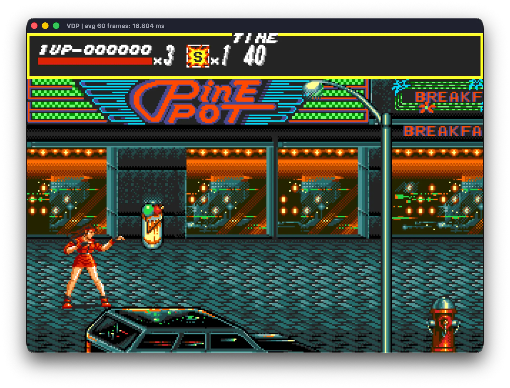
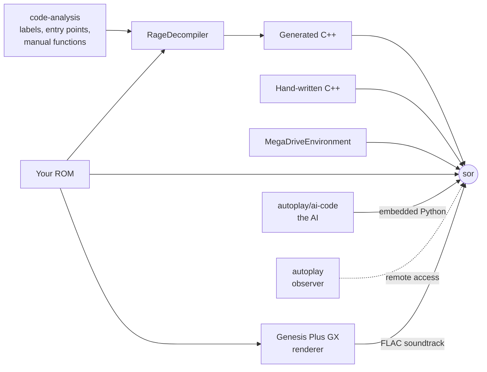
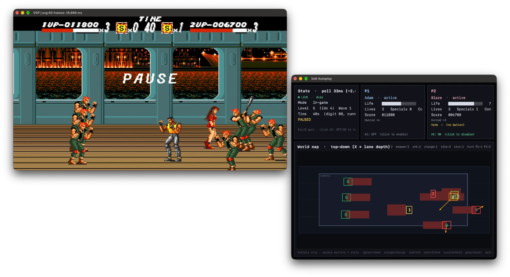

# Developer Journey and Project Structure

[Back to the README](../README.md)

 

*Streets of Rage* is a 512 KiB Mega Drive cartridge. This document tells how it became a C++
program that runs on Windows, macOS, Linux and the PS5, plays a lossless render of its own
soundtrack and can be played by an AI, and where each piece of that work lives.

- [The project at a glance](#the-project-at-a-glance)
- [Reading the game](#reading-the-game)
- [From 68000 code to C++: `RageDecompiler`](#from-68000-code-to-c-ragedecompiler)
- [A console for the C++ to run on: `MegaDriveEnvironment`](#a-console-for-the-c-to-run-on-megadriveenvironment)
- [Replacing generated code by hand](#replacing-generated-code-by-hand)
- [Where faithful was not enough](#where-faithful-was-not-enough)
- [An AI that plays by the rules: `autoplay`](#an-ai-that-plays-by-the-rules-autoplay)
- [Getting it to players](#getting-it-to-players)
- [Where it is going](#where-it-is-going)
- [Acknowledgments](#acknowledgments)

## The project at a glance

| Directory                                                               | What it holds                                                                                  |
| ----------------------------------------------------------------------- | ---------------------------------------------------------------------------------------------- |
| [`RageDecompiler/`](../RageDecompiler/)                                 | Python tools for disassembly, recompilation, label generation and runtime discovery            |
| [`MegaDriveEnvironment/`](../MegaDriveEnvironment/)                     | The SDL3-based Mega Drive host runtime, also usable as a library for new games                 |
| [`StreetsOfRageRecompilation/`](../StreetsOfRageRecompilation/)         | The game: generated and hand-written C++, analysis data, the `sor` executable and the PS5 port |
| [`autoplay/`](../autoplay/)                                             | The symbolic AI, and the Python observer that watches a running `sor`                          |
| [`StreetsOfRageBuilder/`](../StreetsOfRageBuilder/)                     | The guided installer: tools, source, ROM, soundtrack, build and shortcuts                      |
| [`MegaDriveEnvironmentSampleGame/`](../MegaDriveEnvironmentSampleGame/) | A small game that targets both the PC runtime and real Mega Drive hardware                     |

`MegaDriveEnvironment`, `RageDecompiler` and `StreetsOfRageRecompilation` must stay sibling
directories, which is how the meta-repository lays them out.

## Reading the game

The work rests on two things other people made: [gsaurus's annotated disassembly](https://github.com/gsaurus/sor-disassemblies/)
was the starting point for the analysis, and [Genesis Plus GX](https://github.com/ekeeke/genesis-plus-gx)
served almost as technical documentation for the console.

What the project learned on top of them is kept in `StreetsOfRageRecompilation`, in three places:

- **`code-analysis/`** is the data that guides recompilation and analysis: the labels, the
  auxiliary addresses and the list of routines rewritten by hand.
- **`output/`** is the whole program as assembly, for human inspection and, above all, so that LLMs
  can study its behavior and structure. It comes from the ROM, so Git ignores it;
  `./scripts/disassemble_to_asm.py` creates it.
- **`ai-analysis/`** holds manuscripts on each system of the game, from the graphics engine to
  each boss's state machine, written with several frontier language models.

[Researching](Researching.md) shows how to use all of this.

## From 68000 code to C++: `RageDecompiler`

`RageDecompiler` disassembles the ROM and transpiles the routines it needs into C++. It is
deliberately frugal: it should emit no more code than the game needs to run. The cartridge contains
dead code that the game never reaches, and I want to keep it out of the recompilation, so translating
the whole ROM was never the goal. The hard part is knowing where the live code *is*, because patterns
such as jump tables hide it.

The recompiler starts from what it can prove: the routines reachable from address `0x200` and from
the interrupt autovectors, and everything those reach by direct calls. Routines reached only
indirectly are invisible to that walk, so it also reads
`StreetsOfRageRecompilation/code-analysis/aux_addresses.txt`, a list of the further places to look.
The executable closes the loop: `sor --aux-addr-file FILE` appends to that file any address it is
asked to call and has no function for, then exits with status 42.

I first assumed that playing the game would expose a few entry points, and that those would lead
to almost everything else. The control flow turned out to be far more tangled than that, with the
same subroutine referenced from many call sites. Hence the speculative mode: the recompiler searches
the ROM for anything that looks like code, emits it, and prepares for the calls that might reach it.
Running the game then confirms which guesses were right and adds them to `aux_addresses.txt`, dozens
or hundreds of addresses in a single compilation, without restarting the game. Only confirmed
addresses are kept, which is what keeps the dead code out.

So discovery became a loop:

**exercise the game** → **record new addresses** → **recompile** → **play again**

## A console for the C++ to run on: `MegaDriveEnvironment`

Translated code still talks to the Mega Drive's video, audio and input hardware, so it needs that
hardware to exist. `MegaDriveEnvironment` provides it: an emulated VDP (Video Display Processor),
sound chips, controllers and related devices, which use SDL3 to reach the host's operating system.

This lets the recompilation run long before its rendering, audio and other hardware-facing code
have been rewritten. It is also useful on its own. A new Mega Drive game can be developed as a
native PC application against the emulated VDP instead of Vulkan or DirectX, with between 90% and
100% of its code shared with a ROM for an emulator or the original hardware, or built as a
conventional application for Windows, macOS or Linux.
[`MegaDriveEnvironmentSampleGame`](../MegaDriveEnvironmentSampleGame/) demonstrates that workflow,
including a basic resource-packaging system for tiles, audio samples and Z80 programs.

## Replacing generated code by hand

Generated C++ runs, but it reads like translated opcodes. More than a hundred routines have been
rewritten by hand with help from LLMs, and `code-analysis/manual_functions.txt` lists them. They
range from the decompressor and the "wait for VBlank" loops that busy-waited to input, the menus,
sound commands, and object and boss routines.

The one rule that shapes all of this: **rewritten code never moves the game's state**. Every field
stays in the original Mega Drive work RAM, at its original address, width and encoding, updated on
the same frame as the ROM would. The rule exists because of the AI, which reads the game by
address: move a field into a C++ object and the AI goes blind to it.

The ROM itself stays untouched as well. Patching it fails its boot checksum, and the game hangs.

## Where faithful was not enough

Some things had to go beyond the cartridge, and each became a decision of its own.

**Sound.** The game composes its music on the 68000 and spends much of its time in bus handshakes
with the Z80. Those cost nothing on the console but a lot on the host, so real-time chip emulation
never sounded good enough. Instead, a [renderer built on Genesis Plus GX](Playing.md#pre-rendered-soundtrack)
plays every track, effect and voice from your ROM through the ROM's own sound engine into lossless
FLAC, and `sor` plays those files on the frames the game asks for them. Each music track is split
into two stems because the game's fade treats them differently: FM fades out, while the drums and
PSG stop at once.

**Input.** The game reads the keyboard and gamepads itself and binds them to actions rather than
Mega Drive buttons, which is what makes the [six-button scheme](Playing.md#controls) and
per-player bindings possible.

**Timing.** Monitors no longer run at the game's rate. In `--frame-sync auto` the internal timer is
the clock, and frames are presented with vsync without the game waiting for them, so the speed is
right on any monitor without tearing or per-monitor setup.

**Widescreen.** [Mode 48](Playing.md#widescreen-mode-48) is a VDP mode real hardware never had. The
first version showed the extra columns but centred only the sprites, which left them 32 pixels off
their background: shop shutters left their doorways, and a player falling into a hole in round 4
fell 32 pixels away from the hole drawn on screen. Now every layer is centred. The whole story is
in the [widescreen log book](WidescreenLogBook.md).

**Quality of life.** The camera, a friend's grab and the [other options](Playing.md#quality-of-life-settings)
change the original game, so they are all off by default.

## An AI that plays by the rules: `autoplay`

`autoplay` is, first of all, a window onto the running game. It attaches to `sor` through the remote-access
library in `MegaDriveEnvironment` (`megadrive_remote`) and shows a live HUD with the game mode,
level, wave, timer and each player's status, along with a 2D map of the actors on and off screen.

Having read the game so thoroughly, the obvious next step was to let something play it. The AI is
symbolic, with no training and no neural network. It can anticipate an enemy because the
reverse-engineering uncovered the routine that drives that enemy. It has one hard rule: it may read
RAM freely but never write it, so every action goes through the controller, as a human's would, in
whichever control scheme that player has set.

### How it decides

Each tick is one pass of a pipeline built on *tokens*:

1. **Observe:** turn the same snapshot the HUD reads into `Information` tokens: both players, each
   enemy and boss as its own class, weapons, food and hazards.
2. **Infer:** work out the few facts that need calculation, such as being surrounded.
3. **Propose:** generate every `Verb` that makes sense right now: walk, punch, jump-kick, grab and
   suplex, throw a knife, dodge a projectile, open a breakable, advance the stage, call the police.
4. **Filter:** withdraw any verb that would hurt the other player, human or AI.
5. **Rank:** score each verb's urgency and keep the winner. The HUD shows it, and the candidates it
   beat.
6. **Execute:** the winning verb selects a small, non-blocking state machine that produces this
   tick's buttons.

### Why general rules were not enough

On general rules alone, the AI depended too much on calling the police and walked into punches it
could have seen coming. So the harder opponents got *ROM models*:
Python restatements of an enemy's state machine, timings and hitboxes, which the AI plays forward to
choose its next move. The street enemies (Garcia, Signal, Haku-Ro and Nora) share one lookahead.
Jack and every boss (Antonio, Souther, Abadede, Bongo, Onihime & Yasha, and Mr. X) have a model and
a plan of their own. Movement relies on a standalone rectangle path finder that steers around walls,
floor holes, props and round 6's drop press.

Reading the ROM kept turning up answers no amount of play would have suggested. Souther never
escapes a hold, and releasing him lands him in position for another grab. Abadede's run never
re-aims, so a walk in from 17 or 18 lanes away delivers him into a hold. Bongo never touches anyone
himself: only his flame hurts.

### Measured, not assumed

No behaviour change ships without being measured against the running game, and a session of changes
that made the AI worse was reverted whole. These scores come with food and the police switched off,
since a plan that survives only because it ate is not a plan:

| Opponent     | Before                     | After                                  |
| ------------ | -------------------------- | -------------------------------------- |
| Antonio      | 3.25 hits, 13-32 s         | 0 hits (Blaze, Axel), 0.2 (Adam), 2.2-9 s |
| Souther      | 2.15 hits, 17-27 s         | 0 hits in 16 fights (Blaze), 2-4 s     |
| Abadede      | 7 hits, 31 s               | 0 hits for all three, 2.4-5.6 s        |
| Bongo        | 7 hits, 2 lives            | 0 flame hits for all three, 3.3-4.4 s  |
| Souther pair | 7.6 hits, 3 of 9 games lost | 1.75 hits, 0 of 12 games lost         |
| Street enemies, ten runs | 131 hits       | 70 hits                                |

Measuring taught its own lessons:

- Identical code could spread from 0 to 12 hits, so a fight is judged over many runs, never one.
- Four "lost" runs turned out not to be losses at all. The console had reset, because a debug sweep
  had written a death into an enemy slot that was still spawning.
- The AI's physics projection ran at twice the true speed, as the game moves objects at 30 Hz. The
  correct fix made it *worse* (65 hits against 47 in 16 Antonio fights), because its plans had been
  tuned around the error. The fix was reverted: being right mattered less than the measurement.

The Python helpers put the AI straight in front of any round's boss
(`scripts/play.py --preset boss --level N`) or run it in turbo, and a recorded stall can be replayed
offline through the real pipeline.

### 1 PLAYER AI ASSIST

The AI can play from that separate program, or inside the game as a mode of its own: a two-player
game with the AI on the second player. `sor` embeds its own CPython, independent of any Python on
the machine, and runs the same code that the external `autoplay` uses.
`autoplay/ai-code` is that code, and `sor --ai-path DIR` names another folder. `autoplay` can still
run alongside, but only the first player is then its to play.

The design is described in [`autoplay/AI.md`](../autoplay/AI.md), launch instructions and options
are in [`autoplay/README.md`](../autoplay/README.md), and the ROM models, measurements and test
procedures are in [`autoplay/CLAUDE.md`](../autoplay/CLAUDE.md).

## Getting it to players

Building from source takes a compiler, several dependencies and some patience, so
[Streets of Rage Builder](BuildingDesktop.md#using-the-builder-recommended) does it in a guided
window, from installing the tools to placing the shortcuts.

The [PS5 port](BuildingPS5.md) goes further still from the original hardware: an installed homebrew
title drawn through Mesa's RADV, with its own statically linked Python. Its whole toolchain is built
in a container, so the computer that builds it needs little more than a container engine.

## Where it is going

1. **Reimplement every game procedure in C++.**
2. **Make that C++ readable,** with named routines, fields and constants in place of translated
   opcodes, while keeping the original gameplay rules and the work-RAM layout.
3. **Remove the dependency on the emulated hardware,** implementing graphics, audio (already
   bypassed) and input (already reimplemented) directly through SDL. This replaces the emulated
   devices, not the work-RAM layout.
4. **Enable enhancements** such as higher-resolution replacement assets, and variable frame rates
   through rendering interpolation, with the game logic still advancing one original frame at a
   time.

## Acknowledgments

I would like to thank [ekeeke for the Genesis Plus GX](https://github.com/ekeeke/genesis-plus-gx), which served almost as technical documentation for the SEGA Mega Drive, and [gsaurus for the Streets of Rage](https://github.com/gsaurus/sor-disassemblies/) disassembly (and annotations), which provided an important starting point for the analysis of the game. And of course, my slaves: Claude, ChatGPT, and Grok 4.5. Without them, this work would be impossible for my meat brain to do as a side project!
