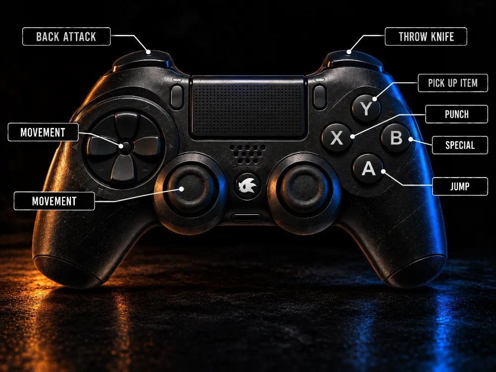

# Playing

[Back to the README](../README.md)

- [Starting the game](#starting-the-game)
- [Game modes](#game-modes)
- [Controls](#controls)
- [Pausing and forfeiting](#pausing-and-forfeiting)
- [Video settings](#video-settings)
- [Quality-of-life settings](#quality-of-life-settings)
- [Widescreen (Mode 48)](#widescreen-mode-48)
- [Pre-rendered soundtrack](#pre-rendered-soundtrack)
- [Keyboard shortcuts](#keyboard-shortcuts)
- [Debug cheats](#debug-cheats)
- [Startup flags](#startup-flags)

## Starting the game

**With the Builder,** double-click **StreetsOfRageRecompilation**.
**StreetsOfRageRecompilation Launcher** opens a window with all the options instead.

**Built by hand,** run one of these from the root of the repository (on Windows,
`py .\scripts\NAME.py`). The first opens the same launcher window. The second starts the game at once,
and passes anything after it to the game as [startup flags](#startup-flags).

```bash
./scripts/play.py
```

```bash
./scripts/run.py
```

**On the PS5,** select the tile on the home screen. [Building for PlayStation 5](BuildingPS5.md#playing-on-the-console)
lists what differs there.

## Game modes

The menu has the original 1 and 2 player games, and two rows the cartridge never had:

- **1 PLAYER AI ASSIST:** a two-player game with [the AI](DeveloperJourney.md#1-player-ai-assist) as
  your partner. Choose your character, then the one for the `COMPUTER`. The mode appears only if the
  game can find the AI's code.
- **QUIT**, after OPTIONS, ends the game.

## Controls

Each player has a control scheme:

- **ORIGINAL 3** (the default) is the original three-button game: Special, Punch and Jump. Punch picks
  items up, and Punch+Jump is the back attack.
- **ENHANCED 6** adds Back Attack, Pick Item and Throw Knife. Punch never picks up, and Punch with a
  knife always stabs and never throws.

### Keyboard

| Action                   | Player 1                           | Player 2        |
| ------------------------ | ---------------------------------- | --------------- |
| Directions               | Arrow keys                         | `W` `S` `A` `D` |
| Special (police call)    | `Z`                                | `H`             |
| Punch                    | `X`                                | `J`             |
| Jump                     | `C`                                | `K`             |
| Back Attack (ENHANCED 6) | `V`                                | `Y`             |
| Pick Item (ENHANCED 6)   | `B`                                | `U`             |
| Throw Knife (ENHANCED 6) | `N`                                | `I`             |
| Start                    | `V` (ORIGINAL 3), `M` (ENHANCED 6) | `L`             |

### Gamepad

Player 1 gets the first gamepad found and player 2 the next, unless you assign one. This is ENHANCED 6:

<p align="center">
 
</p>

In ORIGINAL 3, Special moves to the R1/RB button.

### Changing them

Open **OPTIONS > CONTROLS** and choose **PLAYER 1** or **PLAYER 2**:

| Entry             | What it does                                                                     |
| ----------------- | -------------------------------------------------------------------------------- |
| SCHEME            | ORIGINAL 3 or ENHANCED 6                                                         |
| DEVICE            | AUTO (the first free gamepad), one of the detected gamepads, or NONE             |
| BIND GAMEPAD      | Press a button for each action in turn                                           |
| BIND KEYBOARD     | Press a key for each direction, action and Start in turn                         |
| JOYSTICK DEADZONE | Shows the left stick and its tilt; Left/Right change the deadzone                |
| BACK              | Back to CONTROLS                                                                 |

Any keyboard or gamepad can move through these screens. Use the arrows, the D-pad or either player's
direction keys to move. Enter, the South button or any Punch, Jump or Special binding confirms. Start or
Esc goes back.

While binding, a key or button already given to an earlier action is refused, and Start (on any gamepad)
or Esc cancels without changing anything.

Controls are saved at once in `~/.config/StreetsOfRageProject/controls.yaml`
(`%USERPROFILE%\.config\StreetsOfRageProject\controls.yaml` on Windows). The settings files below live in
the same folder.

## Pausing and forfeiting

Start pauses the game and opens a menu. **RESUME**, or Start again, goes back to the game. With the
pre-rendered soundtrack, the music keeps playing a little quieter.

**FORFEIT** asks "ARE YOU SURE PLAYER N?", with the cursor on NO. YES takes away that player's continues
and lives, and they die at once. In a two-player game each player is asked in turn and answers only for
themself, so one can give up while the other plays on. In 1 PLAYER AI ASSIST the first player answers for
both.

## Video settings

Open **OPTIONS > VIDEO**:

- **VSYNC:** `AUTO` keeps the game's own speed on any screen with no tearing, and is the one to use unless
  you have a reason not to. `VSYNC`, `VSYNC HALF` and `VSYNC THIRD` tie the speed to the screen, every 1, 2
  or 3 refreshes; the menu shows your refresh rate and the speed that gives.
- **PICTURE:** `ORIGINAL 4:3`, or `WIDESCREEN 16:9` for a [wider view of the game](#widescreen-mode-48).
- **DISPLAY:** `WINDOW` or `FULLSCREEN`.
- **INTEGER SCALING:** sharp, even pixels, with borders around the picture.
- **RESET TO DEFAULTS:** puts the defaults back on the screen. They count only after SAVE AND APPLY.
- **SAVE AND APPLY:** uses the settings at once and keeps them for next time, in `video.yaml`.
- **CANCEL:** leaves without changing anything, as do Start and Esc.

An option given on the command line wins over the file for that run. The screen still shows it and can
change it, and SAVE AND APPLY saves what the screen shows.

## Quality-of-life settings

These change the original game, so they are all off by default. Open **OPTIONS > QUALITY-OF-LIFE**, which
has two pages (Left/Right on the PAGE row turn it). The name in brackets turns an option on from the
command line.

**Page 1**

- **ROLL CAMERA EARLIER** (`cam`): the camera rolls with the player at 30% of the screen instead of 55%,
  so more of the street is ahead. On round 8, which scrolls left, at 70% instead of 45%.
- **FRIEND GRAB KEEPS WEAPON** (`grab`): a friend who grabs you no longer makes you drop your weapon. It is
  hidden during the hold and back in your hand after it. An enemy's grab still drops it, and so does any
  hit, a friend's throw included.
- **ENEMY DAMAGE CIRCLES** (`damage`): a regular enemy that has taken damage shows a see-through ring, with
  a disc inside that grows with the damage and fills the ring when the enemy dies. The colour tells the
  kind of enemy: Garcia blue, Nora red, Signal yellow, Haku-Ro purple, Jack dark grey. Bosses keep the bar
  the original game gives them.
- **CHEAT ENABLED** (`cheat`): OPTIONS always has the lives and starting-round rows, which the original game
  hides behind a secret button combination. Turning this on in the menu asks for Special+Punch+Jump+Right;
  Start gives up (OPTIONS on the console). The lives and round you choose last until the game closes.

**Page 2**

- **SAVE HIGH SCORES** (`scores`): keeps the high-score table between runs, in `highscores.yaml`. SAVE AND
  APPLY with it off deletes the file.
- **PLAYER 1 INITIALS** and **PLAYER 2 INITIALS**: set on an on-screen keyboard. A player with initials skips
  name entry on a high score and goes straight to the continue prompt; without them, the original screen
  appears. Under 1 PLAYER AI ASSIST the AI is always `AI`.

SAVE AND APPLY keeps everything in `qol.yaml`. `--qol cam,grab` turns those options on for one run, over the
file; the screen still shows them and can change them, and SAVE AND APPLY saves what it shows.

## Widescreen (Mode 48)

`WIDESCREEN 16:9` in the [video settings](#video-settings), or `--widescreen`, replaces Mode 40 (320×224)
with Mode 48, a VDP mode that exists only in this project and that real hardware does not have. The picture
is 48×27 tiles (384×216, 16:9). The game's logic is unchanged, so the extra columns show whatever the game
already leaves in the planes and the sprite table:

- layers A and B and the sprites each show 4 more tiles on each side (sprites at X 96-480), so sprites stay
  exactly where they are on their background;
- the window plane keeps its 40 columns, centred on screen;
- the first tile row of every layer is not displayed;
- the gameplay HUD loses its yellow frame and gray plate and moves one tile down, to clear that hidden row.

Remote-access framebuffer snapshots and debug PNGs are 384×216 too. The
[widescreen log book](WidescreenLogBook.md) records how it was built.

## Pre-rendered soundtrack

By default `sor` plays a soundtrack rendered from your ROM by
[Genesis Plus GX](https://github.com/ekeeke/genesis-plus-gx) with the Nuked OPN2 core (YM3438, no low-pass
filter, 48 kHz, lossless FLAC): every music track, looping from its own loop point as on the console, every
sound effect and every PCM voice. Real-time chip emulation on the host sounds noticeably worse, for the
reasons [told in the journey](DeveloperJourney.md#where-faithful-was-not-enough).

`scripts/render_soundtrack.py`, the last step of the
[build for your platform](BuildingDesktop.md#step-4-build-and-run), takes about four minutes and writes
~265 MB to `StreetsOfRageRecompilation/rom/soundtrack/`, next to the ROM. The renders come from the
copyrighted ROM, so they stay there and are never versioned.

### What sounds different

The game's own sound engine still runs and only its chip output is replaced, so music starts, fades, the pause
jingle and the stop commands all happen on the same frames as on hardware. Each music track is stored as two
stems that add up to the full mix, because the game's fade treats them differently: the drums (DAC) and the PSG
stop at once while the FM fades out over 1.3 seconds.

One difference is deliberate: on the console a sound effect borrows a music channel while it plays, and here
the music keeps playing under it. Under `--turbo` the music stays at normal speed.

### Choosing another soundtrack

A soundtrack folder is the FLAC files plus their `manifest.tsv`. To make a second one with the other chip, the
Model 1 YM2612:

```bash
./scripts/render_soundtrack.py --chip ym2612 --out ~/sor-audio
```

Then point the game at it, or turn the renders off and use the real-time chips:

```bash
./scripts/run.py --soundtrack ~/sor-audio
```

```bash
./scripts/run.py --sound emulated
```

In the launcher window these are the **Sound** and **Soundtrack folder** fields of the host panel, where an
empty folder means next to the ROM.

If the soundtrack is missing, `sor` warns and emulates the chips. The PS5 has no such fallback.

## Keyboard shortcuts

| Shortcut | Available       | Effect                                                                                                            |
| -------- | --------------- | ----------------------------------------------------------------------------------------------------------------- |
| `Ctrl+F` | Always          | Switch between window and fullscreen, for this session only                                                       |
| `Ctrl+Q` | Always          | Quit cleanly                                                                                                      |
| `Ctrl+R` | `--debug-utils` | Cold-restart the game, keeping the process and the remote TCP connection                                          |
| `Ctrl+P` | `--debug-utils` | Save the composited frame as `screenshot_NNN.png`                                                                 |
| `Ctrl+S` | `--debug-utils` | Save a complete VDP diagnostic view as `vdp_NNN.png`, including the frame, tile sheets, nametables and registers  |

Captures go to the current working directory.

## Debug cheats

These are tools for investigating the game, not part of it, and exist only under `--debug-utils`. Hold **Alt**
on Windows and Linux or **Option** on macOS, and press the key. They work from the keyboard only.

| Key     | Effect                                                                                                      |
| ------- | ----------------------------------------------------------------------------------------------------------- |
| `L`     | Add one Player 1 life, up to `0xFF`                                                                         |
| `S`     | Add one Player 1 special attack, up to `0xFF`                                                               |
| `P`     | Toggle Player 1 punch damage ×12, capped at the cartridge's maximum damage nibble                           |
| `K`     | Kill all instantiated enemies, bosses included, through their normal lethal states                          |
| `W`     | Call the police for the active player without using a special attack                                        |
| `1`–`8` | Jump to that level's intro                                                                                  |
| `G`     | Kill every **Garcia** (types `$20`–`$23`)                                                                   |
| `N`     | Kill every **Haku-Ro**, the ninja (types `$25`, `$2A`)                                                      |
| `B`     | Kill every **Signal** (type `$24`)                                                                          |
| `J`     | Kill every **Jack** (type `$27`)                                                                            |
| `U`     | Kill every **Nora** (type `$26`)                                                                            |
| `X`     | Round 8: kill every enemy and boss on the way to **Mr. X**; once his office scene is up (types `$33`-`$35`), it does nothing, leaving him and his Garcias to fight |

The family kills use the same forced-death sweep as `K`, so score, HUD and cleanup run as they do for a normal
defeat. They cover ordinary enemies only: bosses have their own lethal paths, and `X` is the only exception. Each
letter is the enemy's initial where that was free: Signal takes `B` and Nora `U`, since `S` adds a special attack
and `N` is the ninja.

## Startup flags

`sor --help` prints these in the same groups, and `--version` prints the version. On Windows, the game opens a
console only for `--debug-utils`, `--debug-log`, `--call-log`, `--aux-addr-file`, `--help` or `--version`.

### Game

| Flag            | Meaning                                                                                                |
| --------------- | ------------------------------------------------------------------------------------------------------ |
| `--rom PATH`    | ROM image to load. Default: `rom/SOR.bin`                                                              |
| `--lang jp\|en` | Console language: `jp` is Japanese, `en` is overseas. Default: `en`                                    |
| `--hz 50\|60`   | Console video standard: `60` is NTSC, `50` is PAL. Default: `60`                                       |
| `--qol A,B`     | Turn on [quality-of-life options](#quality-of-life-settings) for this run: `cam`, `grab`, `damage`, `scores`, `cheat` |
| `--default-qol` | Ignore `qol.yaml` for this run, keeping anything `--qol` turns on. For scripts and measurements        |

### Video

| Flag                                                | Meaning                                                                                                     |
| --------------------------------------------------- | ----------------------------------------------------------------------------------------------------------- |
| `--fullscreen`, `--windowed`                        | Start in desktop fullscreen, or in a window. Default: as in `video.yaml`                                    |
| `--widescreen`, `--no-widescreen`                   | Use [Mode 48](#widescreen-mode-48) instead of Mode 40, or not                                               |
| `--integer-scaling`, `--no-integer-scaling`         | Scale by whole multiples only, centred with borders and nearest-neighbour: 320×224 on a 1920×1080 screen is drawn 4× at 1280×896 |
| `--frame-sync auto\|vsync\|vsync-half\|vsync-third` | What sets the game's speed. `auto`, the default, is the internal timer: right on any monitor, with no tearing, and VRR monitors can follow it (use fullscreen for VRR). The others follow the monitor, every 1, 2 or 3 refreshes |
| `--default-video`                                   | Ignore `video.yaml` for this run, keeping any other video option given. For scripts and measurements        |

### Audio

| Flag                            | Meaning                                                                                                                                        |
| ------------------------------- | ---------------------------------------------------------------------------------------------------------------------------------------------- |
| `--silent`                      | No audio at all, not even the soundtrack                                                                                                       |
| `--sound prerendered\|emulated` | `prerendered` plays the [FLAC soundtrack](#pre-rendered-soundtrack) and is the default, falling back to `emulated` if it is missing. `emulated` runs the YM2612, PSG and Z80 DAC in real time |
| `--soundtrack DIR`              | Soundtrack folder. Default: `soundtrack/` next to the ROM                                                                                      |

### AI

| Flag            | Meaning                                                                                                                                  |
| --------------- | ---------------------------------------------------------------------------------------------------------------------------------------- |
| `--ai-path DIR` | Folder holding the AI's code (the `sor_ai` package). Default: `ai-code` in the current folder; `scripts/run.py` passes the repository's  |
| `--ai-assist`   | The second player is the AI from launch, whichever mode is chosen                                                                        |

### Development

| Flag                   | Meaning                                                                                                                                                        |
| ---------------------- | -------------------------------------------------------------------------------------------------------------------------------------------------------------- |
| `--debug-utils`        | Enable the debug [shortcuts](#keyboard-shortcuts), [cheats](#debug-cheats) and remote access                                                                   |
| `--port PORT`          | With `--debug-utils`, the remote-access TCP port. Default: `6969`; `0` disables it                                                                             |
| `--turbo N`            | Run at `60 × N` Hz, on the timer unless `--frame-sync` says otherwise                                                                                          |
| `--debug-log`          | Log CPU and VDP state once per second                                                                                                                          |
| `--call-log PATH`      | Write every 68000 subroutine entry and call to a [CSV log](Researching.md#who-calls-whom-the-call-map), replacing the file                                     |
| `--aux-addr-file PATH` | [Discovery mode](Researching.md#finding-missing-code): append an unknown indirect-dispatch address to this file and exit with status `42` instead of aborting  |
| `--console-menus`      | Show the PS5's menus on the desktop, for testing                                                                                                               |
